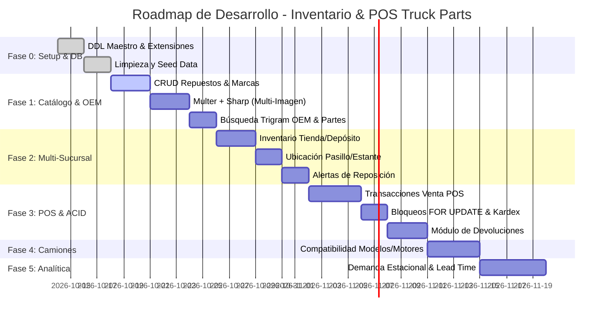

# 🚚 ROADMAP Y ARQUITECTURA TÉCNICA: SISTEMA DE INVENTARIO MULTI-SUCURSAL Y POS (TRUCK PARTS)

**Rol:** Arquitecto de Software Senior & Tech Lead  
**Stack Principal:** Node.js (ES Modules), Express 5, PostgreSQL 15+, Sharp, Multer  
**Ubicación del Documento:** `backend-inventario-truck-parts/docs/ROADMAP.md`

---

## 1. DIAGNÓSTICO DEL ESQUEMA EXISTENTE (`src/database/init.sql`)

Al auditar el archivo original `src/database/init.sql`, se identificaron los siguientes puntos críticos que impedían soportar los requerimientos de escala, concurrencia y multi-sucursal:

1. **Duplicidad de Código DDL:**
   - El archivo cuenta con dos bloques casi idénticos concatenados (Líneas 1-130 y 131-268), provocando errores de redeclaración de tablas e índices en entornos de migración limpia.
2. **Dependencias Circulares y Orden de Creación Invalido:**
   - La tabla `repuesto` declara una llave foránea hacia `brand(id_brand)`, pero la tabla `brand` es creada al final del archivo (Línea 263).
3. **Inconsistencia y Monolitismo en el Control de Stock:**
   - El stock se encuentra modelado estáticamente en `item.stock` y en `repuesto.stock`. En un modelo automotriz multi-sucursal con piso de venta y bodega, esto causa desincronización inmediata. El stock debe pertenecer a una relación entre **Ítem + Sucursal + Ubicación Física (Tienda vs. Depósito)**.
4. **Multimedia Monotoma:**
   - `item.photo` solo almacena una única URL en VARCHAR(512), impidiendo guardar despieces técnicos, múltiples ángulos y miniaturas optimizadas.
5. **Búsqueda OEM Ineficiente:**
   - Falta de sanitización/normalización de códigos de repuestos (los usuarios buscan `A000-429-3795` como `A0004293795` o `0004293795`) y ausencia de extensiones para búsqueda difusa (`pg_trgm`).
6. **Carencia de Capa Transaccional (POS y Devoluciones):**
   - No existen tablas de ventas, detalles, pagos, devoluciones ni Kardex de movimientos de inventario.

---

## 2. DISEÑO DE BASE DE DATOS (POSTGRESQL EXTENDIDO)

A continuación se presenta el DDL normalizado, estructurado con orden de dependencias estricto, llaves primarias compuestas/secuenciales, restricciones de integridad referencial, checks de no-negatividad e índices optimizados B-Tree y GIN con `pg_trgm`.

```sql
-- =========================================================================
-- EXTENSIONES Y CONFIGURACIÓN INICIAL
-- =========================================================================
CREATE EXTENSION IF NOT EXISTS "uuid-ossp";
CREATE EXTENSION IF NOT EXISTS "pg_trgm"; -- Acelera búsquedas difusas con ILIKE y similitud trigram

-- =========================================================================
-- 1. TABLAS MAESTRAS DEL CATÁLOGO
-- =========================================================================

-- Marcas de fabricantes / repuesteras (Wabco, Bendix, Bosch, Meritor, etc.)
CREATE TABLE IF NOT EXISTS brand (
    id_brand SERIAL PRIMARY KEY,
    brand_name VARCHAR(50) NOT NULL UNIQUE,
    country VARCHAR(30),
    logo_url VARCHAR(512),
    created_at TIMESTAMP WITH TIME ZONE DEFAULT CURRENT_TIMESTAMP
);

-- Entidad Maestra: Ítem / Repuesto (Definición técnica y base comercial)
CREATE TABLE IF NOT EXISTS item (
    id_item SERIAL PRIMARY KEY,
    item_name VARCHAR(100) NOT NULL,
    item_description TEXT NOT NULL,
    id_brand INT REFERENCES brand(id_brand) ON DELETE RESTRICT,
    sku VARCHAR(50) UNIQUE,
    cost DECIMAL(12,2) NOT NULL DEFAULT 0.00 CHECK (cost >= 0),
    price DECIMAL(12,2) NOT NULL DEFAULT 0.00 CHECK (price >= 0),
    is_active BOOLEAN NOT NULL DEFAULT TRUE,
    created_at TIMESTAMP WITH TIME ZONE DEFAULT CURRENT_TIMESTAMP,
    updated_at TIMESTAMP WITH TIME ZONE DEFAULT CURRENT_TIMESTAMP
);

-- =========================================================================
-- 2. MULTIMEDIA POR REPUESTO (MÚLTIPLES FOTOS)
-- =========================================================================
CREATE TABLE IF NOT EXISTS item_image (
    id_image SERIAL PRIMARY KEY,
    id_item INT NOT NULL REFERENCES item(id_item) ON DELETE CASCADE,
    image_url VARCHAR(512) NOT NULL,
    thumbnail_url VARCHAR(512),
    is_primary BOOLEAN NOT NULL DEFAULT FALSE,
    display_order INT NOT NULL DEFAULT 0,
    created_at TIMESTAMP WITH TIME ZONE DEFAULT CURRENT_TIMESTAMP
);

-- =========================================================================
-- 3. CÓDIGOS OEM Y REFERENCIAS CRUZADAS (AFTERMARKET)
-- =========================================================================
CREATE TABLE IF NOT EXISTS item_oem (
    id_item_oem SERIAL PRIMARY KEY,
    id_item INT NOT NULL REFERENCES item(id_item) ON DELETE CASCADE,
    oem_code VARCHAR(100) NOT NULL,
    clean_oem_code VARCHAR(100) NOT NULL, -- Código sin espacios, guiones ni puntos
    brand_origin VARCHAR(100),            -- Marca del camión/fabricante OEM (Volvo, Scania, Freightliner)
    oem_type VARCHAR(20) NOT NULL DEFAULT 'ORIGINAL' CHECK (oem_type IN ('ORIGINAL', 'AFTERMARKET', 'CROSS_REFERENCE')),
    is_main BOOLEAN NOT NULL DEFAULT FALSE,
    created_at TIMESTAMP WITH TIME ZONE DEFAULT CURRENT_TIMESTAMP
);

-- =========================================================================
-- 4. SUBTIPOS Y ESPECIFICACIONES TÉCNICAS (1 a 1 CON ITEM)
-- =========================================================================
CREATE TABLE IF NOT EXISTS seal (
    id_item INT PRIMARY KEY REFERENCES item(id_item) ON DELETE CASCADE,
    height DECIMAL(10,2) DEFAULT 0.0,
    inner_diameter DECIMAL(10,2) DEFAULT 0.0,
    outer_diameter DECIMAL(10,2) DEFAULT 0.0,
    material VARCHAR(30)
);

CREATE TABLE IF NOT EXISTS bearing (
    id_item INT PRIMARY KEY REFERENCES item(id_item) ON DELETE CASCADE,
    bearing_code VARCHAR(30),
    height DECIMAL(10,2) DEFAULT 0.0,
    inner_diameter DECIMAL(10,2) DEFAULT 0.0,
    outer_diameter DECIMAL(10,2) DEFAULT 0.0,
    bearing_type VARCHAR(30)
);

CREATE TABLE IF NOT EXISTS valve (
    id_item INT PRIMARY KEY REFERENCES item(id_item) ON DELETE CASCADE,
    number_inputs INT DEFAULT 0,
    thread_size DECIMAL(10,2) DEFAULT 0.0,
    valve_type VARCHAR(30)
);

CREATE TABLE IF NOT EXISTS sensor (
    id_item INT PRIMARY KEY REFERENCES item(id_item) ON DELETE CASCADE,
    voltage INT DEFAULT 24,
    thread_size DECIMAL(10,2) DEFAULT 0.0,
    pins_count INT DEFAULT 2
);

CREATE TABLE IF NOT EXISTS repairkit (
    id_item INT PRIMARY KEY REFERENCES item(id_item) ON DELETE CASCADE,
    valve_compatibility INT REFERENCES valve(id_item) ON DELETE SET NULL,
    kit_type VARCHAR(50)
);

-- =========================================================================
-- 5. COMPATIBILIDAD CON VEHÍCULOS (CAMIONES Y MOTORIZACIÓN - FASE 2)
-- =========================================================================
CREATE TABLE IF NOT EXISTS truck (
    id_truck SERIAL PRIMARY KEY,
    truck_brand VARCHAR(50) NOT NULL,       -- Mack, Kenworth, Freightliner, International, Volvo, Scania
    truck_model VARCHAR(50) NOT NULL,       -- Cascadia, T680, Anthem, FH16, etc.
    engine_model VARCHAR(80),              -- Detroit DD15, Cummins ISX/X15, Mack MP8, Paccar MX13
    first_year INT NOT NULL,
    last_year INT,                         -- NULL si sigue en producción
    notes TEXT
);

CREATE TABLE IF NOT EXISTS item_truck_compatibility (
    id_item INT NOT NULL REFERENCES item(id_item) ON DELETE CASCADE,
    id_truck INT NOT NULL REFERENCES truck(id_truck) ON DELETE CASCADE,
    position_note VARCHAR(100),            -- 'Eje delantero', 'Lado conductor', 'Sistema neumático primario'
    PRIMARY KEY (id_item, id_truck)
);

-- =========================================================================
-- 6. MULTI-SUCURSAL Y GESTIÓN DE UBICACIÓN FÍSICA
-- =========================================================================
CREATE TABLE IF NOT EXISTS sucursal (
    id_sucursal SERIAL PRIMARY KEY,
    code VARCHAR(20) NOT NULL UNIQUE,       -- 'SUC-01', 'BOD-CENTRAL'
    name VARCHAR(100) NOT NULL,
    address TEXT NOT NULL,
    phone VARCHAR(30),
    is_main_hub BOOLEAN NOT NULL DEFAULT FALSE,
    is_active BOOLEAN NOT NULL DEFAULT TRUE,
    created_at TIMESTAMP WITH TIME ZONE DEFAULT CURRENT_TIMESTAMP
);

-- Stock físico segregado: Piso de Venta (TIENDA) vs. Almacén Central (DEPOSITO)
CREATE TABLE IF NOT EXISTS inventario_stock (
    id_inventario SERIAL PRIMARY KEY,
    id_item INT NOT NULL REFERENCES item(id_item) ON DELETE RESTRICT,
    id_sucursal INT NOT NULL REFERENCES sucursal(id_sucursal) ON DELETE RESTRICT,
    tipo_almacen VARCHAR(20) NOT NULL CHECK (tipo_almacen IN ('TIENDA', 'DEPOSITO')),
    pasillo VARCHAR(20) NOT NULL DEFAULT 'S/P',
    estante VARCHAR(20) NOT NULL DEFAULT 'S/E',
    seccion VARCHAR(20) NOT NULL DEFAULT 'S/S',
    cantidad INT NOT NULL DEFAULT 0 CHECK (cantidad >= 0),
    stock_minimo INT NOT NULL DEFAULT 0 CHECK (stock_minimo >= 0), -- Umbral de alerta para TIENDA
    stock_maximo INT DEFAULT NULL,
    updated_at TIMESTAMP WITH TIME ZONE DEFAULT CURRENT_TIMESTAMP,
    CONSTRAINT uq_stock_location UNIQUE (id_item, id_sucursal, tipo_almacen, pasillo, estante, seccion)
);

-- Kardex de auditoría / Movimientos de inventario
CREATE TABLE IF NOT EXISTS inventario_movimiento (
    id_movimiento SERIAL PRIMARY KEY,
    id_item INT NOT NULL REFERENCES item(id_item) ON DELETE RESTRICT,
    id_sucursal INT NOT NULL REFERENCES sucursal(id_sucursal) ON DELETE RESTRICT,
    tipo_movimiento VARCHAR(30) NOT NULL CHECK (tipo_movimiento IN (
        'VENTA_POS', 'DEVOLUCION_POS', 'TRASPASO_TIENDA_DEPOSITO', 
        'TRASPASO_SUCURSAL', 'AJUSTE_ENTRADA', 'AJUSTE_SALIDA', 'COMPRA_RECEPCION'
    )),
    origen_tipo VARCHAR(20),                -- 'TIENDA', 'DEPOSITO', 'PROVEEDOR', 'EXTERNO'
    destino_tipo VARCHAR(20),               -- 'TIENDA', 'DEPOSITO', 'CLIENTE', 'MERMA'
    cantidad INT NOT NULL CHECK (cantidad != 0),
    stock_previo INT NOT NULL,
    stock_posterior INT NOT NULL,
    referencia_id INT,                      -- ID de venta, ID de devolución o ID de compra
    usuario_responsable VARCHAR(100),
    motivo TEXT,
    created_at TIMESTAMP WITH TIME ZONE DEFAULT CURRENT_TIMESTAMP
);

-- =========================================================================
-- 7. MÓDULO DE PUNTO DE VENTA (POS) Y DEVOLUCIONES
-- =========================================================================
CREATE TABLE IF NOT EXISTS venta (
    id_venta SERIAL PRIMARY KEY,
    numero_factura VARCHAR(50) NOT NULL UNIQUE,
    id_sucursal INT NOT NULL REFERENCES sucursal(id_sucursal) ON DELETE RESTRICT,
    cliente_nombre VARCHAR(120) DEFAULT 'CLIENTE GENERAL',
    cliente_documento VARCHAR(30),
    vendedor_id INT,
    subtotal DECIMAL(12,2) NOT NULL DEFAULT 0.00 CHECK (subtotal >= 0),
    impuesto DECIMAL(12,2) NOT NULL DEFAULT 0.00 CHECK (impuesto >= 0),
    descuento DECIMAL(12,2) NOT NULL DEFAULT 0.00 CHECK (descuento >= 0),
    total DECIMAL(12,2) NOT NULL DEFAULT 0.00 CHECK (total >= 0),
    metodo_pago VARCHAR(30) NOT NULL CHECK (metodo_pago IN ('EFECTIVO', 'TARJETA', 'TRANSFERENCIA', 'CREDITO', 'MIXTO')),
    estado VARCHAR(20) NOT NULL DEFAULT 'COMPLETADA' CHECK (estado IN ('COMPLETADA', 'ANULADA', 'DEVUELTA_PARCIAL', 'DEVUELTA_TOTAL')),
    created_at TIMESTAMP WITH TIME ZONE DEFAULT CURRENT_TIMESTAMP
);

CREATE TABLE IF NOT EXISTS venta_detalle (
    id_detalle SERIAL PRIMARY KEY,
    id_venta INT NOT NULL REFERENCES venta(id_venta) ON DELETE CASCADE,
    id_item INT NOT NULL REFERENCES item(id_item) ON DELETE RESTRICT,
    tipo_almacen_origen VARCHAR(20) NOT NULL DEFAULT 'TIENDA' CHECK (tipo_almacen_origen IN ('TIENDA', 'DEPOSITO')),
    cantidad INT NOT NULL CHECK (cantidad > 0),
    precio_unitario DECIMAL(12,2) NOT NULL CHECK (precio_unitario >= 0),
    costo_unitario DECIMAL(12,2) NOT NULL CHECK (costo_unitario >= 0),
    descuento DECIMAL(12,2) NOT NULL DEFAULT 0.00 CHECK (descuento >= 0),
    subtotal DECIMAL(12,2) NOT NULL CHECK (subtotal >= 0)
);

CREATE TABLE IF NOT EXISTS devolucion (
    id_devolucion SERIAL PRIMARY KEY,
    id_venta INT NOT NULL REFERENCES venta(id_venta) ON DELETE RESTRICT,
    id_sucursal INT NOT NULL REFERENCES sucursal(id_sucursal) ON DELETE RESTRICT,
    tipo_devolucion VARCHAR(20) NOT NULL CHECK (tipo_devolucion IN ('PARCIAL', 'TOTAL')),
    motivo TEXT NOT NULL,
    monto_reembolso DECIMAL(12,2) NOT NULL CHECK (monto_reembolso >= 0),
    metodo_reembolso VARCHAR(30) NOT NULL,
    autorizado_por VARCHAR(100),
    estado VARCHAR(20) NOT NULL DEFAULT 'APROBADA' CHECK (estado IN ('PENDIENTE', 'APROBADA', 'RECHAZADA')),
    created_at TIMESTAMP WITH TIME ZONE DEFAULT CURRENT_TIMESTAMP
);

CREATE TABLE IF NOT EXISTS devolucion_detalle (
    id_devolucion_detalle SERIAL PRIMARY KEY,
    id_devolucion INT NOT NULL REFERENCES devolucion(id_devolucion) ON DELETE CASCADE,
    id_detalle_venta INT NOT NULL REFERENCES venta_detalle(id_detalle) ON DELETE RESTRICT,
    id_item INT NOT NULL REFERENCES item(id_item) ON DELETE RESTRICT,
    cantidad INT NOT NULL CHECK (cantidad > 0),
    destino_almacen VARCHAR(20) NOT NULL DEFAULT 'TIENDA' CHECK (destino_almacen IN ('TIENDA', 'DEPOSITO', 'CUARENTENA')),
    monto_unitario DECIMAL(12,2) NOT NULL CHECK (monto_unitario >= 0),
    subtotal DECIMAL(12,2) NOT NULL CHECK (subtotal >= 0)
);

-- =========================================================================
-- 8. ÍNDICES DE ALTO RENDIMIENTO (B-TREE Y GIN TRIGRAM)
-- =========================================================================

-- Búsqueda de Repuestos por Nombre (Fuzzy / ILIKE acelerado)
CREATE INDEX IF NOT EXISTS idx_item_name_trgm ON item USING gin (item_name gin_trgm_ops);
CREATE INDEX IF NOT EXISTS idx_item_brand ON item (id_brand);
CREATE INDEX IF NOT EXISTS idx_item_sku ON item (sku);

-- Búsqueda por Código OEM exacto y normalizado
CREATE INDEX IF NOT EXISTS idx_item_oem_clean ON item_oem (clean_oem_code);
CREATE INDEX IF NOT EXISTS idx_item_oem_code_trgm ON item_oem USING gin (oem_code gin_trgm_ops);
CREATE INDEX IF NOT EXISTS idx_item_oem_item ON item_oem (id_item);

-- Consultas de Inventario por Sucursal y Tipo de Almacén
CREATE INDEX IF NOT EXISTS idx_stock_lookup ON inventario_stock (id_sucursal, tipo_almacen, id_item);
CREATE INDEX IF NOT EXISTS idx_stock_item ON inventario_stock (id_item);

-- Consultas de Ventas y Reportes
CREATE INDEX IF NOT EXISTS idx_venta_sucursal_fecha ON venta (id_sucursal, created_at DESC);
CREATE INDEX IF NOT EXISTS idx_venta_detalle_item ON venta_detalle (id_item);

-- =========================================================================
-- 9. VISTA: ALERTAS DE REPOSICIÓN TIENDA VS. DEPÓSITO
-- =========================================================================
CREATE OR REPLACE VIEW v_alertas_reposicion_interna AS
SELECT 
    s.id_sucursal,
    s.name AS sucursal_nombre,
    i.id_item,
    i.item_name,
    i.sku,
    b.brand_name,
    COALESCE(st_tienda.cantidad, 0) AS stock_tienda,
    COALESCE(st_tienda.stock_minimo, 1) AS stock_minimo_tienda,
    st_tienda.pasillo AS tienda_pasillo,
    st_tienda.estante AS tienda_estante,
    st_tienda.seccion AS tienda_seccion,
    COALESCE(st_deposito.cantidad, 0) AS stock_deposito_disponible,
    st_deposito.pasillo AS deposito_pasillo,
    st_deposito.estante AS deposito_estante,
    st_deposito.seccion AS deposito_seccion
FROM item i
JOIN sucursal s ON s.is_active = TRUE
LEFT JOIN brand b ON i.id_brand = b.id_brand
-- Stock en Piso de Venta (Tienda)
LEFT JOIN inventario_stock st_tienda ON st_tienda.id_item = i.id_item 
    AND st_tienda.id_sucursal = s.id_sucursal 
    AND st_tienda.tipo_almacen = 'TIENDA'
-- Stock en Bodega/Almacén (Depósito)
LEFT JOIN inventario_stock st_deposito ON st_deposito.id_item = i.id_item 
    AND st_deposito.id_sucursal = s.id_sucursal 
    AND st_deposito.tipo_almacen = 'DEPOSITO'
WHERE 
    COALESCE(st_tienda.cantidad, 0) <= COALESCE(st_tienda.stock_minimo, 1) -- Quiebre o stock mínimo en tienda
    AND COALESCE(st_deposito.cantidad, 0) > 0;                             -- Pero hay mercancía en depósito para surtir
```

---

## 3. ARQUITECTURA Y ESTRUCTURA DE ARCHIVOS

Se adopta una **Arquitectura Modular por Dominio** (Feature-Based / Domain Layered), garantizando bajo acoplamiento, alta cohesión y testeabilidad sin depender de librerías sobrecargadas.

```text
backend-inventario-truck-parts/
├── docs/
│   └── ROADMAP.md                   <-- Documento maestro de arquitectura y fases
├── uploads/                         <-- Almacenamiento local (imágenes optimizadas)
│   ├── original/
│   └── thumbs/
├── src/
│   ├── app.js                       <-- Configuración del servidor Express
│   ├── server.js                    <-- Punto de entrada e inicio de escucha HTTP
│   ├── config/
│   │   ├── database.js              <-- Pool nativo pg con validaciones
│   │   └── storage.config.js        <-- Variables S3 / GCP / Local
│   ├── database/
│   │   ├── init.sql                 <-- Script DDL maestro
│   │   ├── runMigration.js          <-- Script de ejecución de DDL
│   │   └── seeds/                   <-- Datos demo (marcas, sucursales, repuestos)
│   │       └── seed.sql
│   ├── common/                      <-- Utilidades y helpers compartidos
│   │   ├── errors/
│   │   │   ├── AppError.js
│   │   │   └── errorHandler.js      <-- Middleware global de captura de errores
│   │   ├── middlewares/
│   │   │   ├── upload.middleware.js <-- Multer con MemoryStorage
│   │   │   └── validate.middleware.js
│   │   └── utils/
│   │       ├── transactionHelper.js <-- withTransaction(pool, callback)
│   │       └── stringSanitizer.js   <-- Limpieza de códigos OEM
│   ├── modules/
│   │   ├── catalog/                 <-- Catálogo de Repuestos, OEM y Multimedia
│   │   │   ├── controllers/
│   │   │   │   ├── item.controller.js
│   │   │   │   └── oem.controller.js
│   │   │   ├── services/
│   │   │   │   ├── item.service.js
│   │   │   │   ├── imageProcessor.service.js  <-- Sharp (WebP, resize, thumbs)
│   │   │   │   └── storage.service.js         <-- Local / S3 provider
│   │   │   ├── repositories/
│   │   │   │   ├── item.repository.js
│   │   │   │   └── oem.repository.js
│   │   │   └── routes/
│   │   │       └── catalog.routes.js
│   │   ├── inventory/               <-- Multi-Sucursal, Ubicaciones y Alertas
│   │   │   ├── controllers/
│   │   │   │   ├── inventory.controller.js
│   │   │   │   └── alert.controller.js
│   │   │   ├── services/
│   │   │   │   ├── inventory.service.js
│   │   │   │   └── restockAlert.service.js    <-- Detección quiebre tienda vs depósito
│   │   │   ├── repositories/
│   │   │   │   ├── inventory.repository.js
│   │   │   │   └── alert.repository.js
│   │   │   └── routes/
│   │   │       └── inventory.routes.js
│   │   ├── pos/                     <-- Punto de Venta y Devoluciones
│   │   │   ├── controllers/
│   │   │   │   ├── pos.controller.js
│   │   │   │   └── return.controller.js
│   │   │   ├── services/
│   │   │   │   ├── pos.service.js             <-- Lógica transaccional ACID con FOR UPDATE
│   │   │   │   └── return.service.js          <-- Devolución y reintegración al stock
│   │   │   ├── repositories/
│   │   │   │   ├── sale.repository.js
│   │   │   │   └── return.repository.js
│   │   │   └── routes/
│   │   │       └── pos.routes.js
│   │   ├── compatibility/           <-- Fase 2: Camiones y Motores
│   │   │   ├── controllers/
│   │   │   ├── services/
│   │   │   ├── repositories/
│   │   │   └── routes/
│   │   └── analytics/               <-- Fase 3: Estacionalidad y Predicción Importaciones
│   │       ├── services/
│   │       └── routes/
└── package.json
```

---

## 4. DECISIONES TÉCNICAS Y PATRONES DE ARQUITECTURA

### 4.1. Estrategia de Procesamiento y Almacenamiento Multimedia
* **Problema:** Las imágenes de repuestos subidas por el usuario suelen ser pesadas (cámaras de 12-48 MP), en formatos no optimizados (JPEG/PNG) y ralentizan la carga del POS.
* **Solución Arquitectónica:**
  1. **Recepción:** `multer.memoryStorage()` captura el archivo directamente como Buffer en RAM (con límite de 10 MB por archivo y filtro MIME `image/jpeg, image/png, image/webp`).
  2. **Pipeline de Optimización con `sharp`:**
     - **Web Ready (Original Optimizado):** Máximo 1200 px de ancho, formato **WebP**, compresión al 82% de calidad.
     - **Thumbnail (POS y Grid):** Cuadrado 300x300 px, `fit: 'contain'` con fondo transparente o blanco, formato **WebP**, calidad 80%.
  3. **Patrón Strategy de Almacenamiento:**
     - En **Desarrollo**: Guardado en disco local (`/uploads/original` y `/uploads/thumbs`).
     - En **Producción**: Subida a bucket compatible con S3 / Google Cloud Storage, guardando en base de datos la URL pública o CDN.

```javascript
// src/modules/catalog/services/imageProcessor.service.js
import sharp from 'sharp';
import path from 'path';
import { v4 as uuidv4 } from 'uuid';

export class ImageProcessorService {
  static async processPartImage(fileBuffer, originalName) {
    const filename = `${uuidv4()}.webp`;

    // 1. Imagen principal optimizada para web
    const originalWebP = await sharp(fileBuffer)
      .resize({ width: 1200, withoutEnlargement: true })
      .webp({ quality: 82 })
      .toBuffer();

    // 2. Thumbnail rápido para POS
    const thumbnailWebP = await sharp(fileBuffer)
      .resize(300, 300, { fit: 'contain', background: { r: 255, g: 255, b: 255, alpha: 0 } })
      .webp({ quality: 80 })
      .toBuffer();

    return { filename, originalWebP, thumbnailWebP };
  }
}
```

---

### 4.2. Persistencia y Manejo Transaccional ACID en POS
* **Evaluación de ORMs vs. Driver Nativo `pg`:**
  - **Prisma:** Requiere un motor binario separado (Rust engine), alto consumo de memoria en contenedores, latencias extra y transacciones interactivas con timeout estricto que fallan frecuentemente bajo bloqueos pesimistas de alta concurrencia.
  - **Drizzle ORM:** Excelente alternativa para TypeScript, pero añade complejidad de configuración en proyectos JS puro con ES Modules sin compilación.
  - **Driver Nativo `pg` (Selección Oficial):** Máximo rendimiento, cero overhead, control granular del pool de conexiones y soporte nativo sin abstracciones para la instrucción crítica `SELECT ... FOR UPDATE`.
* **Manejo de Transacciones y Prevención de Venta en Negativo:**
  Para evitar condiciones de carrera cuando dos cajeros intentan facturar la última pieza en paralelo, se implementa el helper `withTransaction` con bloqueo pesimista determinista:

```javascript
// src/common/utils/transactionHelper.js
export const withTransaction = async (pool, callback) => {
  const client = await pool.connect();
  try {
    await client.query('BEGIN');
    const result = await callback(client);
    await client.query('COMMIT');
    return result;
  } catch (error) {
    await client.query('ROLLBACK');
    throw error;
  } finally {
    client.release();
  }
};
```

**Lógica de Bloqueo en POS (`pos.service.js`):**
```javascript
// Dentro de withTransaction(pool, async (client) => { ... })
// 1. Bloqueo determinista ordenado para prevenir deadlocks
const queryLock = `
  SELECT id_inventario, id_item, cantidad 
  FROM inventario_stock 
  WHERE id_sucursal = $1 AND tipo_almacen = 'TIENDA' AND id_item = ANY($2::int[])
  ORDER BY id_inventario ASC
  FOR UPDATE;
`;
const { rows: lockedStock } = await client.query(queryLock, [sucursalId, itemIdsArray]);

// 2. Verificación estricta de stock disponible en memoria transaccional
for (const item of itemsSolicitados) {
  const stockRow = lockedStock.find(s => s.id_item === item.id_item);
  if (!stockRow || stockRow.cantidad < item.cantidad) {
    throw new Error(`Stock insuficiente para el repuesto ID ${item.id_item}. Disponible: ${stockRow ? stockRow.cantidad : 0}`);
  }
}

// 3. Descuento del stock e inserción en venta_detalle y kardex...
```

---

### 4.3. Algoritmo de Alerta de Reposición Tienda vs. Depósito
* **Regla de Negocio:**
  Si en una sucursal el stock en el piso de venta (`TIENDA`) es $\le$ al stock mínimo fijado (o llega a 0), y en la misma sucursal existe inventario en el almacén interno (`DEPOSITO`) con cantidad $> 0$, el sistema debe alertar al personal con la ubicación física exacta (Pasillo / Estante / Sección) de dónde ir a buscar las piezas en depósito.
* **Consulta SQL Optimizada:**

```sql
SELECT 
    i.id_item,
    i.item_name,
    i.sku,
    b.brand_name,
    st_tienda.cantidad AS stock_actual_mostrador,
    st_tienda.stock_minimo AS minimo_mostrador,
    st_tienda.pasillo AS tienda_pasillo,
    st_tienda.estante AS tienda_estante,
    st_deposito.cantidad AS stock_disponible_deposito,
    st_deposito.pasillo AS deposito_pasillo,
    st_deposito.estante AS deposito_estante,
    st_deposito.seccion AS deposito_seccion
FROM inventario_stock st_tienda
JOIN item i ON st_tienda.id_item = i.id_item
LEFT JOIN brand b ON i.id_brand = b.id_brand
JOIN inventario_stock st_deposito ON st_deposito.id_item = i.id_item 
    AND st_deposito.id_sucursal = st_tienda.id_sucursal 
    AND st_deposito.tipo_almacen = 'DEPOSITO'
WHERE 
    st_tienda.id_sucursal = $1                  -- Parámetro: Sucursal consultada
    AND st_tienda.tipo_almacen = 'TIENDA'
    AND st_tienda.cantidad <= st_tienda.stock_minimo
    AND st_deposito.cantidad > 0
ORDER BY st_tienda.cantidad ASC, st_deposito.cantidad DESC;
```

---

## 5. HOJA DE RUTA DE DESARROLLO (ROADMAP POR MICRO-FASES)



### Micro-Fase 0: Refactor de Persistencia y Deuda Técnica
- Aplicar nuevo `init.sql` asegurando llaves foráneas y extensiones `pg_trgm`.
- Generar script ejecutable de migración / recreación segura de esquema.
- Insertar catálogo inicial de sucursales demo (e.g. "Sucursal Matriz", "Sucursal Norte").

### Micro-Fase 1: Catálogo Avanzado, Multimedia y Búsqueda OEM (MVP)
- Implementar controlador y servicio para creación y consulta de repuestos.
- Middleware Multer + Sharp para generación automática de versiones web y miniaturas WebP.
- CRUD de números OEM y referencias cruzadas (aftermarket).
- Endpoint `/api/catalog/search?q=...` combinando coincidencias en Nombre, Marca y Códigos OEM mediante operadores `%` y similitud Trigram.

### Micro-Fase 2: Inventario Multi-Sucursal y Alertas de Reposición
- Endpoints de asignación de stock con discriminación de `TIENDA` vs `DEPOSITO`.
- Registro y actualización de coordenadas físicas (Pasillo, Estante, Sección).
- Endpoint `/api/inventory/alerts/restock/:sucursalId` y servicio de notificación de quiebre de mostrador.
- Endpoint de traspaso interno: mover stock de `DEPOSITO` a `TIENDA` con registro automático en Kardex.

### Micro-Fase 3: Módulo de Punto de Venta (POS) y Devoluciones
- Endpoint transaccional `POST /api/pos/sales`:
  - Bloqueo de filas con `SELECT ... FOR UPDATE`.
  - Validación de stock en mostrador (`TIENDA`).
  - Generación de comprobante fiscal / número de factura correlativo.
  - Actualización atómica de inventario y generación de registros en `inventario_movimiento`.
- Endpoint `POST /api/pos/returns`:
  - Procesamiento de devoluciones totales o parciales.
  - Reincorporación del repuesto al inventario (`TIENDA` o `CUARENTENA` para revisión de garantía).

### Micro-Fase 4: Compatibilidad con Vehículos y Motores (Fase 2 del Alcance)
- Tablas de camiones (`truck`), modelos y familias de motores pesados (Cummins, Detroit, Mack, Volvo, Scania).
- Relación de aplicaciones y búsqueda inversa: *"Dado un camión Freightliner Cascadia 2018 con motor DD15, ¿cuáles filtros y válvulas son compatibles?"*.

### Micro-Fase 5: Analítica Estacional y Predicción de Importaciones (Fase 3 del Alcance)
- Vistas materializadas para calcular índice de rotación por trimestre/temporada.
- Algoritmo de cálculo de Punto de Reorden (ROP):
  $$\text{ROP} = (\text{Demanda Diaria Promedio} \times \text{Lead Time en Días}) + \text{Stock de Seguridad}$$
- Dashboard de sugerencias de compra e importación internacional.

---

## 6. GUÍA DE EJECUCIÓN INMEDIATA (FASE 1)

Para arrancar el desarrollo de inmediato sobre la base de código actual:

### Paso 1: Instalar Dependencias de Procesamiento y Validación
Ejecutar en la raíz del proyecto `backend-inventario-truck-parts`:
```bash
npm install sharp multer uuid
```

### Paso 2: Configurar Variables de Entorno (`.env`)
Asegurarse de contar con las siguientes variables en `.env`:
```env
PORT=3000
DB_HOST=localhost
DB_USER=postgres
DB_PASSWORD=tu_password
DB_NAME=inventario_truck_parts
DB_PORT=5432
UPLOAD_DIR=./uploads
BASE_URL=http://localhost:3000
```

### Paso 3: Aplicar el Esquema SQL Extendido
Sobrescribir `src/database/init.sql` con el DDL provisto en la Sección 2 y ejecutar la inicialización en PostgreSQL:
```bash
psql -U postgres -d inventario_truck_parts -f src/database/init.sql
```

### Paso 4: Configurar el Middleware de Carga Multimedia (`src/common/middlewares/upload.middleware.js`)
```javascript
import multer from 'multer';

const storage = multer.memoryStorage();

const fileFilter = (req, file, cb) => {
  const allowedTypes = ['image/jpeg', 'image/png', 'image/webp'];
  if (allowedTypes.includes(file.mimetype)) {
    cb(null, true);
  } else {
    cb(new Error('Formato no soportado. Suba imágenes JPG, PNG o WebP.'), false);
  }
};

export const uploadPartImages = multer({
  storage,
  limits: { fileSize: 10 * 1024 * 1024 }, // 10MB máx por archivo
  fileFilter,
}).array('images', 5); // Hasta 5 fotos simultáneas
```

### Paso 5: Servir la Carpeta de Cargas en `src/app.js`
Agregar en `src/app.js`:
```javascript
import path from 'path';
import { fileURLToPath } from 'url';

const __filename = fileURLToPath(import.meta.url);
const __dirname = path.dirname(__filename);

// Servir estáticos de imágenes procesadas
app.use('/uploads', express.static(path.join(__dirname, '../uploads')));
```

---
*Fin del documento de arquitectura. Listo para aprobación e inicio de implementación incremental.*
